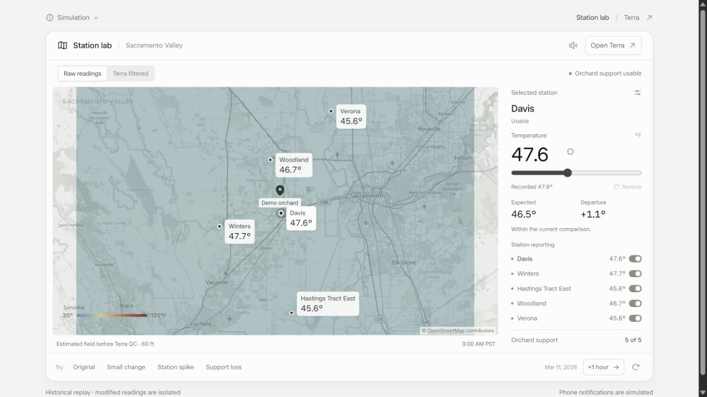
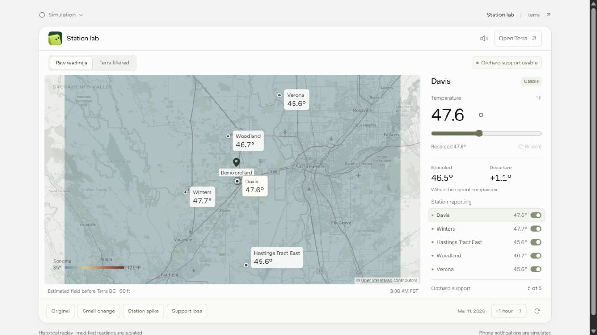

# Station lab visual refinement

This first visual slice builds on the behavior owner's frozen `853336a12e9970fb3d06e5c895e45e4f24366075`. ET reviewed the actual working preview and explicitly selected **Keep this balance** for the map and station controls. This accepts the shown layout; broader sim behavior and future visual work remain separate.

| Original | First refinement |
| --- | --- |
|  |  |

The existing cube asset replaces the redundant header region label. The selected station gets one clear heading/status row, its selected map label and reporting row are easier to locate, and raw/filtered controls have distinct selected states. Scenario buttons retain their original actions with clearer affordances. Temperature/expected/departure values retain their hierarchy. Shared grower-chat styling and behavior are unchanged.

The actual WeatherMap implementation is byte-identical to the frozen baseline. Backend, reference, immutable source data, numerical palette and scenario/notification handlers have no changes. The cube is copied byte-for-byte from the approved ordinary UI asset. Before any controlled action, the stations, assessment, heatmap, messages, notifications and replay clock matched the saved baseline.

Verification: production build, four packaging cases and all ten configured scoped check groups passed against the frozen baseline. Browser checks exercised a real controlled station spike (71.6 F observed, 46.5 F expected, 25.1 F departure), retained usable orchard support with four peers and no phone notification, and displayed the exclusion in the filtered map. Narrow 320px and 390px layouts were inspected. An inherited body minimum width caused a classic-scrollbar overflow; the Station lab-scoped fix gives equal client/scroll widths at 320px. The intermediate two-column layout was inspected at its actual rendered width. Replay state is retained, and all real-SMS/provider/LLM/training/live-state side-effect flags remain false.

The preview is isolated on port 18522 with its own ignored state directory. It does not restart/reset the owner's 8520 simulation or the ordinary live runtime. The working preview can be reviewed while the approved ordinary UI/demo consolidation finishes. This slice should be integrated as one presentation-only change after its source owner selects the release checkpoint; it introduces no cloud hosting or provider activation.
